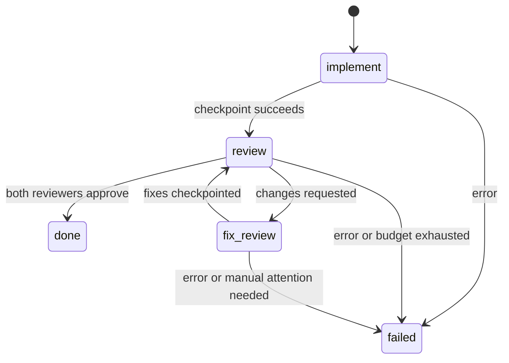

# Plan execution architecture

`crabber-implement <plan>` runs a plan against the current repository. A plan is a Markdown file or a directory of numerically ordered Markdown documents.

## Library ownership

The dmt-flows `flows-api` crate supplies the graph document. `flows-core` compiles and validates it. The same pinned DMT runtime used by dmt-flows schedules the compiled nodes. A local handler invokes Crabber sessions for each work node.

Crabber owns the provider protocol, tool execution and agent sessions. The host owns plan loading, Git checkpoints, review artifacts, review acceptance and the iteration limit.

## Integration candidates

| Candidate | Public API | Cost | Choice |
| --- | --- | --- | --- |
| Compile and embed | `flows_core::compile_version`, `dmt::EngineBuilder`, Crabber `Agent` | One custom handler. Host must enforce occurrence limits. | Selected. Matches the embedded upstream integration test. |
| Embed the HTTP server | `flows_server::build`, `App::router` | Two databases, project preparation, fake guest environment and a subprocess adapter. | Rejected for this local CLI. |

The upstream reference is `../dmt-flows/crates/flows-nodes/tests/support/mod.rs`. Crabber tool configuration follows `../crabber/examples/mount-standard/src/probe.rs`.

## Workflow

Each review is tied to its exact branch and HEAD. Fixes consume the selected review directory. A new review follows every fix checkpoint. Failure, missing reports and an exhausted budget cannot become success.

The compiler currently represents custom work as shell nodes. Their argv values describe the host dispatch operation. The custom handler executes Crabber directly. Compiler-injected acquire and release hooks pass payloads through. They provide no sandbox isolation. Crabber shell tools execute on the host.

## Independent design check

An independent design review preferred compiler plus custom handler for requirement alignment, public ownership boundaries and maintenance cost. It identified the handler's required occurrence-limit, cancellation and retry controls. It also confirmed that the host must implement two review sessions because the mounted Crabber tools do not supply the review skill's Agent tool.

The CLI is a single invocation. In-memory scheduling does not promise crash resume. Git checkpoints and review artifacts preserve its completed work.

## Report ownership

Reviewers return typed findings and one verdict. The host derives severity counts and renders the five Markdown files required by the review skill. Approval and saved reports therefore share one source. Independent review reproduced a false completion when model-provided Markdown contradicted a separate approval envelope. The typed representation removes that duplicate state.

Review context uses committed Git blobs, including the literal content of symlinks. It does not follow changed symlinks into files outside the repository. Each writable session must leave its starting branch and HEAD unchanged before the host stages a checkpoint.
